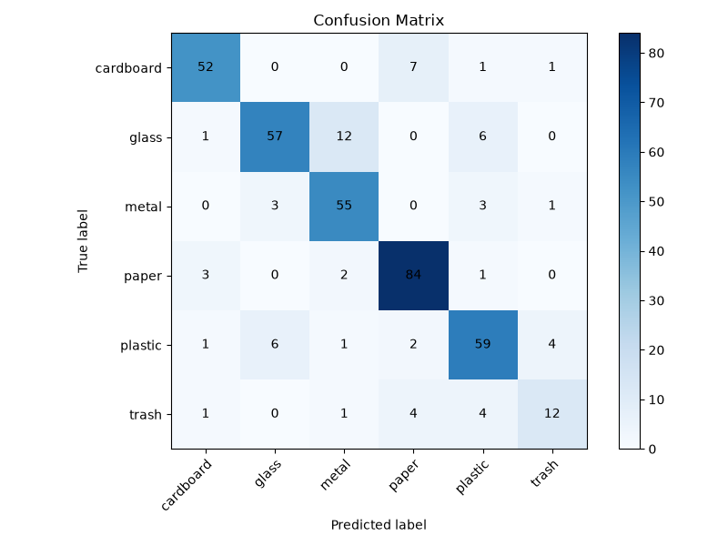

# Smart Waste Classification Using MobileNetV2

An image-classification application that uses transfer learning with MobileNetV2 to recognize six TrashNet waste categories. Upload a JPG, JPEG, or PNG image to the Streamlit app to see the predicted category and the model's class probabilities.

> **Live demo:** [Open Smart Waste Classification](https://smart-waste-classification-mobilenetv2-asmuucuw9xhmjehdxn43yg.streamlit.app/)

## Project Overview

Correctly sorting waste can support recycling and reduce the amount of reusable material sent to landfill. This project explores image classification as an aid for recognizing common waste types.

The project includes scripts to prepare the dataset, train and evaluate a classifier, and a Streamlit frontend for trying the trained model. Predictions are model estimates, not a substitute for local recycling guidance.

### Objectives

- Prepare TrashNet images in reproducible training, validation, and test splits.
- Apply transfer learning with an ImageNet-pretrained MobileNetV2.
- Evaluate the trained classifier using held-out test images.
- Provide a simple web interface for image-based predictions.

## Technologies

- **Python** — programming language
- **TensorFlow / Keras** — deep learning framework
- **MobileNetV2** — pretrained image-classification backbone
- **Streamlit** — web application interface
- **Pillow** — image loading and processing
- **NumPy** — numerical operations
- **Matplotlib** — confusion matrix visualization
- **Scikit-learn** — evaluation metrics and classification report

## Dataset

This project uses the [TrashNet dataset](https://www.kaggle.com/datasets/feyzazkefe/trashnet), organized into six classes:

1. `cardboard`
2. `glass`
3. `metal`
4. `paper`
5. `plastic`
6. `trash`

The dataset is not included in this repository and must be downloaded separately. Arrange the downloaded images in class-named folders as shown below.

## Model and Transfer Learning

The classifier uses **MobileNetV2** pretrained on ImageNet as a feature extractor. Its pretrained base uses `include_top=False` and accepts RGB images of shape `224 × 224 × 3`. The base is initially frozen during training.

The classification head consists of:

1. `GlobalAveragePooling2D`
2. `Dropout(0.2)`
3. `Dense(6, activation="softmax")`

Images are preprocessed with `tf.keras.applications.mobilenet_v2.preprocess_input`. Training uses the Adam optimizer, categorical cross-entropy, and accuracy. Training runs for up to 15 epochs, with early stopping on validation loss and a checkpoint that saves the best model to `models/best_waste_classifier.keras`.

## Project Structure

```text
smart-waste-classification-mobilenetv2/
├── app/
│   └── app.py                         # Streamlit prediction interface
├── data/
│   ├── dataset-resized/               # Original class folders (not tracked)
│   └── split/
│       ├── train/                     # Training images by class
│       ├── val/                       # Validation images by class
│       └── test/                      # Held-out test images by class
├── models/
│   └── best_waste_classifier.keras    # Trained Keras model
├── notebooks/                         # Project notebooks
├── src/
│   ├── prepare_dataset.py             # Creates the reproducible data split
│   ├── train_model.py                 # Trains and saves the classifier
│   └── evaluate_model.py              # Evaluates on the test split
├── confusion_matrix.png                # Saved test-set confusion matrix
├── requirements.txt
├── .gitignore
└── README.md
```

## Dataset Preparation

Put the six class folders under `data/dataset-resized/`:

```text
data/dataset-resized/
├── cardboard/
├── glass/
├── metal/
├── paper/
├── plastic/
└── trash/
```

From the project root, run:

```bash
python src/prepare_dataset.py
```

The script copies images (it does not delete the originals) into `data/split/` using a fixed random seed of `42`. Each class is split into approximately **70% training, 15% validation, and 15% testing**. Integer rounding can place the remainder in the test split. The script prints per-class counts for each split.

## Installation and Setup

Use Python in a virtual environment. From the project root:

### Windows PowerShell

```powershell
python -m venv .venv
.\.venv\Scripts\Activate.ps1
python -m pip install --upgrade pip
pip install -r requirements.txt
```

### macOS or Linux

```bash
python3 -m venv .venv
source .venv/bin/activate
python -m pip install --upgrade pip
pip install -r requirements.txt
```

The trained model is included in the repository at `models/best_waste_classifier.keras` and is required to run the frontend. The Streamlit application loads this model; it does not train a model.

## Train and Evaluate

Run these commands from the project root:

```bash
python src/prepare_dataset.py
python src/train_model.py
python src/evaluate_model.py
```

The evaluation script loads only `data/split/test/`. It prints the test metrics and per-class classification report, then saves and displays `confusion_matrix.png` in the project root.

## Run the Streamlit Application

From the project root, start the app with:

```bash
streamlit run app/app.py
```

Upload a JPG, JPEG, or PNG image to view the predicted category, model confidence, and probabilities for all six categories.

## Evaluation Results

The following results are from the held-out test set:

| Metric | Result |
|---|---:|
| Test accuracy | **83.07%** |
| Weighted precision | **83.12%** |
| Weighted recall | **83.07%** |
| Weighted F1-score | **82.88%** |

### Per-Class Results

The following per-class metrics and support counts are calculated from the saved test confusion matrix (`confusion_matrix.png`):

| Class | Precision | Recall | F1-score | Support |
|---|---:|---:|---:|---:|
| Cardboard | 89.66% | 85.25% | 87.39% | 61 |
| Glass | 86.36% | 75.00% | 80.28% | 76 |
| Metal | 77.46% | 88.71% | 82.71% | 62 |
| Paper | 86.60% | 93.33% | 89.84% | 90 |
| Plastic | 79.73% | 80.82% | 80.27% | 73 |
| Trash | 66.67% | 54.55% | 60.00% | 22 |
| **Total** |  |  |  | **384** |

### Confusion Matrix

The matrix shows the true test class on the vertical axis and the predicted class on the horizontal axis.



## Limitations

- The classifier is limited to the six TrashNet classes and may not recognize waste types outside its training categories.
- Image conditions, object mixtures, camera perspective, and backgrounds can affect predictions.
- A predicted class and confidence are not a guarantee that an item is recyclable; local rules differ.
- The `trash` category has fewer test examples than the other classes in the saved evaluation.

## Future Work

Potential improvements include adding more diverse labeled images, evaluating additional data sources, and comparing performance after carefully validated fine-tuning or data-augmentation experiments.

## Author

**Akula Rohith Kumar**

GitHub: [@rohithkumarakula](https://github.com/rohithkumarakula)
